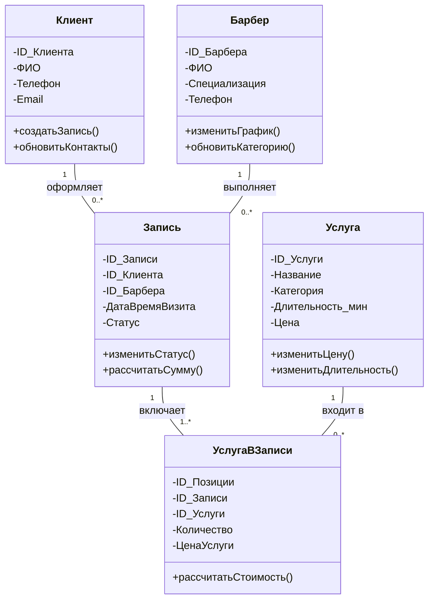

# 💈 Барбершоп «BarberShop» — Проектирование базы данных

Информационная система для автоматизации учета услуг, управления клиентской базой, ведения расписания мастеров и обработки записей в мужской парикмахерской **«BarberShop»**.

## 📋 Описание предметной области

Система предназначена для хранения актуального прейскуранта услуг, базы мастеров, регистрации клиентов и учета визитов. В базе данных фиксируются подробные характеристики каждой услуги (наименование, категория, длительность, стоимость), информация о барберах (ФИО, квалификация, телефон), контактные данные клиентов, а также история записей с детализацией оказанных услуг.

Накопленные данные позволяют администрации барбершопа:

- Отслеживать популярность конкретных стрижек и уходовых процедур.
- Контролировать загруженность мастеров и плотность расписания.
- Отслеживать статусы визитов клиентов (подтвержден, выполнен, отменен).
- Рассчитывать общую выручку барбершопа и выработку мастеров за любой период.

## 📐 Визуальная ER-диаграмма базы данных

## 🗂 Структура базы данных (Сущности и атрибуты)

В ходе проектирования были выделены **5 основных сущностей**, между которыми настроена ссылочная целостность:

| Сущность | Атрибуты (PascalCase) | Тип данных (Access) | Описание |
| :--- | :--- | :--- | :--- |
| **Клиент** | `ID_Клиента` (PK) `ФИО` `Телефон` `Email` | Счетчик Короткий текст Короткий текст Короткий текст | Уникальный код клиента Фамилия, имя и отчество посетителя Контактный номер телефона для SMS-напоминаний Электронная почта для чеков и акций |
| **Барбер** | `ID_Барбера` (PK) `ФИО` `Специализация` `Телефон` | Счетчик Короткий текст Короткий текст Короткий текст | Уникальный табельный номер мастера Фамилия, имя и отчество барбера Грейд мастера («Барбер», «Старший барбер», «Топ-барбер») Контактный номер телефона мастера |
| **Услуга** | `ID_Услуги` (PK) `Название` `Категория` `Длительность_мин` `Цена` | Счетчик Короткий текст Короткий текст Числовой Денежный | Уникальный код услуги в прайсе Наименование услуги (например, «Мужская стрижка», «Моделирование бороды») Раздел прайса (стрижки, борода и усы, уход, комплексы) Среднее время выполнения в минутах Актуальная стоимость услуги |
| **Запись** | `ID_Записи` (PK) `ID_Клиента` (FK) `ID_Барбера` (FK) `ДатаВремяВизита` `Статус` | Счетчик Числовой Числовой Дата и время Короткий текст | Уникальный номер визита Внешний ключ (связь с таблицей `Клиент`) Внешний ключ (связь с таблицей `Барбер`) Дата и время начала записи Текущий статус («Запланирован», «Выполнен», «Отменен») |
| **УслугаВЗаписи** | `ID_Позиции` (PK) `ID_Записи` (FK) `ID_Услуги` (FK) `Количество` `ЦенаУслуги` | Счетчик Числовой Числовой Числовой Денежный | Уникальный код строки в чеке Внешний ключ (связь с таблицей `Запись`) Внешний ключ (связь с таблицей `Услуга`) Количество оказанных услуг в рамках визита Цена услуги, зафиксированная на момент записи |

## 🔗 Логика связей и нормализация

- **Клиент — Запись (`1:N`):** один посетитель может записаться в барбершоп множество раз, но каждая конкретная запись принадлежит строго одному клиенту.
- **Барбер — Запись (`1:N`):** один мастер проводит множество визитов, но каждый конкретный визит закреплен за одним выбранным барбером.
- **Запись — УслугаВЗаписи (`1:N`):** один визит может включать в себя сразу несколько разных услуг (например, стрижку, оформление бороды и укладку), но каждая строка чека относится только к одной записи.
- **Услуга — УслугаВЗаписи (`1:N`):** одна и та же услуга из прайса оказывается разным клиентам во множестве визитов, но в конкретной позиции чека указана строго одна услуга.

**Разрешение связи «Многие-ко-многим» (`M:N`):** логическая связь между сущностями `Запись` и `Услуга` (за один визит клиент получает несколько услуг, и одна услуга входит в разные визиты) успешно разрешена с помощью ассоциативной сущности **УслугаВЗаписи**, которая разбила её на две связи типа `1:N`.

## 🛠 Используемые инструменты

- **draw.io (diagrams.net)** — проектирование логической ER/UML-диаграммы классов.
- **Mermaid.js** — встроенная визуализация ER-диаграммы в документации репозитория.
- **Microsoft Access** — физическая реализация таблиц, настройка связей, создание запросов, форм и отчетов.
